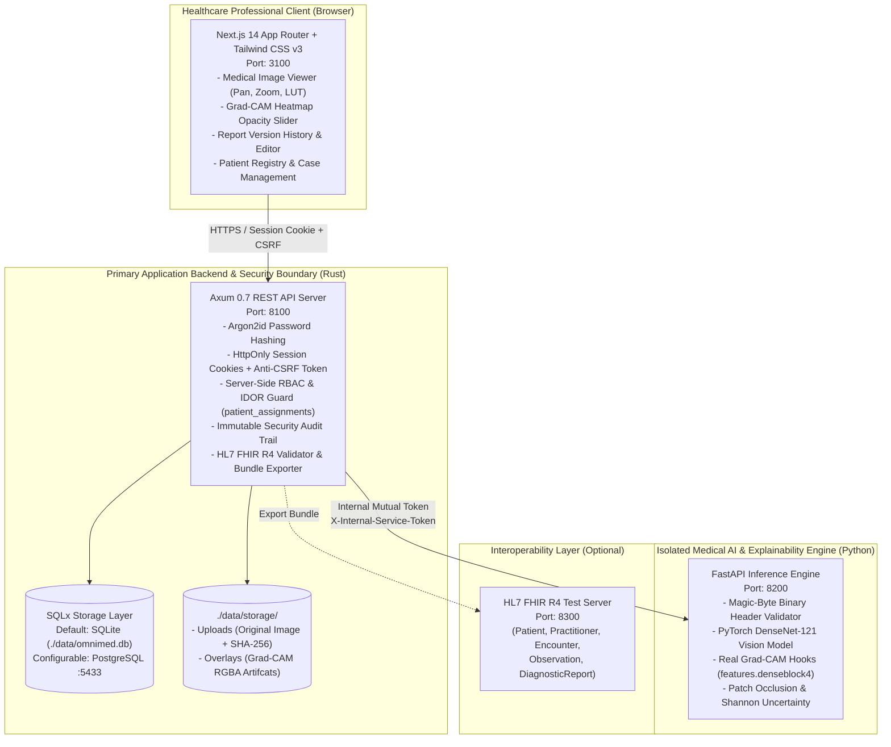

# OmniMed Insight (XAI)

<p align="center">
  <strong>Multimodal Clinical Decision-Support, Explainable Medical AI (Grad-CAM), Evidence-Grounded Report Drafting & HL7 FHIR R4 Interoperability Platform</strong>
</p>

<p align="center">
  
  
  
  
  
  
  
</p>

---

> [!IMPORTANT]
> ### ⚠️ Mandatory Clinical Safety & Regulatory Notice
> **OmniMed Insight (XAI) is an assistive clinical decision-support software platform developed exclusively for qualified healthcare professionals using synthetic test data.**
> - It is **not** an FDA 510(k), CE-marked, or PMDA-cleared medical device.
> - It must **never** be used for autonomous clinical diagnosis or treatment planning.
> - All deep learning inferences, uncertainty metrics, Grad-CAM attribution heatmaps, and evidence-grounded report drafts are auxiliary decision aids that **mandatorily require independent verification and signed clinical attestation by an authorized clinician.**

---

## 📑 Table of Contents
- [1. System Architecture](#1-system-architecture)
- [2. Key Capabilities & Technical Highlights](#2-key-capabilities--technical-highlights)
- [3. Port Allocation & Network Topology](#3-port-allocation--network-topology)
- [4. Repository Structure](#4-repository-structure)
- [5. Quick Start (Windows / macOS / Linux)](#5-quick-start-windows--macos--linux)
- [6. Demo Accounts & RBAC Matrix](#6-demo-accounts--rbac-matrix)
- [7. Step-by-Step Clinical Workflow Guide](#7-step-by-step-clinical-workflow-guide)
- [8. Automated Testing & Verification](#8-automated-testing--verification)
- [9. Data Governance & Security Disclosures](#9-data-governance--security-disclosures)

---

## 1. System Architecture

OmniMed Insight enforces strict architectural boundaries: **Rust** serves as the primary security gateway, session custodian, and regulatory audit boundary, while **Python** executes hardware-calibrated vision inference and gradient-based XAI hooks. The **Next.js** frontend provides a responsive, accessible clinical workspace.



---

## 2. Key Capabilities & Technical Highlights

### 🔬 Explainable AI (XAI) & PyTorch Vision Engine
* **Real Gradient-Weighted Class Activation Mapping (Grad-CAM)**: Forward and backward gradient hooks registered on `features.denseblock4` of PyTorch DenseNet-121 to extract real spatial feature sensitivities without mock approximations.
* **Pixel-Accurate Heatmap Overlay**: Generates full RGBA jet/turbo thermal heatmaps dynamically composited over raw radiographs and MRI scans with a live opacity slider (0%–100%).
* **Predictive Uncertainty Classification**: Evaluates candidate class probabilities using **Shannon Entropy** ($H = -\sum p_i \log_2 p_i$) and classifies inferences into `LOW`, `MODERATE`, or `HIGH` uncertainty.

### 🛡️ Rust Application Security & Zero-Trust Architecture
* **Strict Server-Side RBAC**: Role-based access control enforced on every endpoint (`admin`, `clinician`, `reviewer`, `readonly`). Client-side state is never trusted.
* **Cross-Patient IDOR Prevention**: Care team assignments (`patient_assignments`) strictly restrict clinicians to their authorized patients. Unassigned access triggers `403 Forbidden` and records a security incident in `audit_logs`.
* **State-of-the-Art Cryptography**: Passwords salted and hashed with **Argon2id**. Sessions managed via randomized 256-bit cryptographically secure tokens in `SameSite=Lax` HttpOnly cookies paired with anti-CSRF headers.
* **Lossless Image Integrity**: Validates binary magic signatures (PNG, JPEG, TIFF), calculates SHA-256 digests upon upload, and stores original images unaltered.

### 📋 Evidence-Grounded Report Drafting & Clinician Sign-Off
* **5-Part Standard Radiology Structure**:
  1. *Sourced Clinical Facts & LOINC Observations* (Demographics, vitals, labs, and clinician context notes).
  2. *Configured Model Prediction Output & Uncertainty* (DenseNet-121 top scores, calibration status).
  3. *Grad-CAM Spatial Attribution Interpretation* (Activation quadrant, coverage ratio, gradient notice).
  4. *Clinician Impression & Decision-Support Narrative* (Editable synthesized clinical impression).
  5. *Mandatory Limitations & Safety Disclosures* (Non-autonomous clearance warning).
* **Multi-Version History**: Iterative draft versioning (`v1`, `v2`, `v3`...) with immediate selector and status locks (`APPROVED`, `REJECTED`, `DRAFT_PENDING_REVIEW`).

### 🌐 Dynamic Patient & Imaging Case Management
* **Live Patient Registration**: Register new synthetic patients directly from the UI with automated `SYNTH-MRN` generation, FHIR Patient ID mapping, and automated clinician assignment.
* **On-Demand Case Creation**: Open new CXR (Chest Radiograph) or Brain MRI cases linked to any registered patient with custom priorities (`ROUTINE`, `URGENT`, `STAT`).

### 🏥 HL7 FHIR R4 Interoperability
* Generates validated FHIR R4 JSON Bundles encapsulating `Patient`, `Practitioner`, `Encounter`, `Observation` (LOINC-coded vitals and labs), `ImagingStudy`, and `DiagnosticReport` resources.

---

## 3. Port Allocation & Network Topology

All services are configured centrally via `.env` (derived from `.env.example`) and bind strictly to `127.0.0.1` (`localhost`):

| Service | Port | Protocol | Description |
| :--- | :---: | :--- | :--- |
| **Frontend UI** | `3100` | HTTP | Next.js 14 Web Workspace & Diagnostic Viewer |
| **Primary Backend** | `8100` | HTTP | Rust Axum API, Auth, Security Boundary, FHIR Validator |
| **Python AI Engine** | `8200` | HTTP | Internal PyTorch DenseNet-121 + Grad-CAM Service |
| **FHIR Test Server** | `8300` | HTTP | Optional external HL7 FHIR R4 endpoint |
| **PostgreSQL** | `5433` | TCP | Optional containerized database (SQLite is local default) |

---

## 4. Repository Structure

```text
OmniMed Insight/
├── backend-rust/                  # Primary Rust Backend
│   ├── Cargo.toml                 # Axum, Tokio, SQLx, Argon2 dependencies
│   ├── migrations/                # SQLx database schema migrations
│   │   └── 0001_initial_schema.sql
│   ├── src/
│   │   ├── audit.rs               # Immutable audit logging engine
│   │   ├── auth.rs                # Argon2id, session cookies, IDOR checks
│   │   ├── config.rs              # App configuration & .env parser
│   │   ├── db.rs                  # Connection pool & synthetic data seeder
│   │   ├── error.rs               # Unified API error types
│   │   ├── models.rs              # Typed domain models & DTOs
│   │   ├── routes.rs              # Endpoint handlers & business logic
│   │   ├── lib.rs                 # Router composition & CORS policy
│   │   └── main.rs                # Axum listener entrypoint
│   └── tests/                     # Integration and security test suite
├── ai-service-python/             # Python Medical AI & XAI Engine
│   ├── app/
│   │   ├── config.py              # Environment configuration & token validator
│   │   ├── imaging.py             # Binary magic-byte & SHA-256 verification
│   │   ├── xai_engine.py          # PyTorch DenseNet-121 & Grad-CAM hooks
│   │   └── main.py                # FastAPI endpoints & health checks
│   ├── tests/                     # Pytest suite for inference & XAI
│   └── requirements.txt           # PyTorch, TorchVision, FastAPI, Pillow
├── frontend/                      # Next.js 14 + Tailwind CSS Frontend
│   ├── package.json               # Next.js 14.2, Tailwind v3, Lucide icons
│   ├── src/
│   │   ├── app/
│   │   │   ├── layout.tsx         # Root layout & third-party error boundary
│   │   │   ├── page.tsx           # Multimodal clinical workspace (5 Tabs)
│   │   │   └── globals.css        # Tailwind directives & medical utility styles
│   │   └── components/
│   │       └── MedicalImageViewer.tsx # Interactive canvas viewer (LUT, Zoom, Pan)
│   └── __tests__/                 # Frontend contract & contract tests
├── data/                          # Local application state (gitignored)
│   ├── omnimed.db                 # SQLite relational database
│   └── storage/                   # Uploaded scans & derived Grad-CAM overlays
├── docs/                          # Architectural documentation & UI audits
│   ├── ARCHITECTURE.md            # Comprehensive threat model & specs
│   └── UI_AUDIT.md                # Accessibility & Tailwind v3 checklist
├── run-local.bat                  # One-click Windows Batch launcher
├── run-local.ps1                  # PowerShell launcher with port conflict detection
├── run-local.sh                   # Linux/macOS Bash companion launcher
├── .env.example                   # Environment configuration template
└── README.md                      # Project documentation
```

---

## 5. Quick Start (Windows / macOS / Linux)

### Prerequisites
* **Rust**: `1.75+` (`cargo` and `rustc`)
* **Python**: `3.10+` with `pip`
* **Node.js**: `18+` or `20+` with `npm`

### Method 1: One-Click Launcher (Recommended)

#### On Windows:
Double-click `run-local.bat`, or run via PowerShell:
```powershell
# Preflight check (verifies ports, runtimes, and hides secrets)
powershell -ExecutionPolicy Bypass -File .\run-local.ps1 -CheckOnly

# Start all services with automated health verification:
powershell -ExecutionPolicy Bypass -File .\run-local.ps1
```

#### On Linux / macOS:
```bash
chmod +x ./run-local.sh
./run-local.sh
```

The launcher will:
1. Verify required runtimes (`rustc`, `python`, `node`).
2. Scan for port conflicts on `3100`, `8100`, `8200`, and `8300`.
3. Auto-generate `.env` with secure 256-bit secrets if not present.
4. Start the Python AI service (`:8200`), Rust backend (`:8100`), and Next.js frontend (`:3100`) in controlled sequence.
5. Poll real `/health` endpoints and display an operational dashboard.

Once running, access the workspace at **[http://127.0.0.1:3100](http://127.0.0.1:3100)**.

---

## 6. Demo Accounts & RBAC Matrix

The local development seed provides pre-configured role accounts to test access control and IDOR protections:

| Role | Email | Password | Assigned Permissions |
| :--- | :--- | :--- | :--- |
| **Clinician** | `clinician@omnimed-insight.local` | `Clinician!2026` | Register patients, open cases, upload scans, run Grad-CAM XAI, author/edit drafts, sign off reports. Assigned to `pat-synth-001` and `pat-synth-002`. |
| **System Admin** | `admin@omnimed-insight.local` | `AdminAlpha2026!` | Manage users, view full audit log trail, access all patient cases across departments. |
| **Senior Reviewer** | `reviewer@omnimed-insight.local` | `Reviewer!2026` | Inspect completed cases, review XAI evidence, approve or reject report drafts. (Write/Edit disabled). |
| **Clinical Observer** | `readonly@omnimed-insight.local` | `Readonly!2026` | Read-only view of patient charts and completed reports. (All mutations blocked). |
| **Isolated Clinician** | `dr.other@omnimed-insight.local` | `Clinician!2026` | Assigned exclusively to `pat-synth-003`. Used for testing cross-patient IDOR boundaries. |

---

## 7. Step-by-Step Clinical Workflow Guide

1. **Sign In**: Log in as `clinician@omnimed-insight.local` with password `Clinician!2026`.
2. **Patient & Case Registry**:
   * Navigate to the **Patients & Cases** tab.
   * Click **`+ Tambah Pasien Baru (+ Add Patient)`** to register a new synthetic patient with custom vitals and clinical history.
   * On any patient card, click **`+ Buka Kasus Baru`** to launch a new CXR or Brain MRI imaging case.
3. **Image & XAI Workspace**:
   * Select a case. Upload a PA chest radiograph or brain MRI scan (PNG/JPEG).
   * Click **`Execute Medical Image & Grad-CAM Analysis`**. PyTorch DenseNet-121 runs forward and backward passes, computing class logits and spatial sensitivity maps.
   * Adjust the **Grad-CAM Opacity Slider** (0%–100%), switch **Invert LUT**, and zoom in to inspect attribution focus.
   * Enter optional attending notes and click **`Generate Evidence-Grounded Report Draft →`**.
4. **Report Drafting & Sign-Off**:
   * The workspace switches to the **Report Drafting & Review** tab.
   * Inspect the synthesized 5-part report (sourced facts, model predictions, Grad-CAM quadrant summary, impression narrative, and mandatory safety limitations).
   * Switch between draft versions using the **Daftar Versi Laporan** bar (`v1`, `v2`, etc.).
   * In the right column, enter clinical attestation notes and click **`Approve Draft`** or **`Reject Draft`**.
5. **FHIR R4 Bundle Export**:
   * Open the **FHIR R4 Bundle** tab to inspect or download the complete interoperable HL7 FHIR JSON bundle.
6. **Audit & System Status**:
   * Switch to the **Audit & System Status** tab to review the immutable audit log recording your actions with timestamp and user ID.

---

## 8. Automated Testing & Verification

Every layer contains dedicated automated test suites:

### 1. Python AI Service Tests (PyTest)
```bash
python -m pytest ai-service-python/tests/test_inference.py -v
# Output: 6 passed (Inference, Grad-CAM, Patch Occlusion, Magic Bytes, Token Auth)
```

### 2. Rust Backend Security & Integration Tests (Cargo Test)
```bash
cd backend-rust
cargo test
# Output: 3 passed
# - test_report_drafting_clinician_review_and_fhir_r4_bundle ... ok
# - test_health_and_authentication_lifecycle ... ok
# - test_cross_patient_idor_prevention_and_rbac_boundaries ... ok
```

### 3. Frontend Contract & Type Validation
```bash
cd frontend
npx tsc --noEmit
node __tests__/ui_contracts.test.mjs
# Output: 0 TypeScript errors, 3/3 contract tests passed
```

---

## 9. Data Governance & Security Disclosures

* **Synthetic Data Labeling**: All seeded and generated records are explicitly tagged with `is_synthetic = 1` and `[SYNTHETIC]` prefixes to eliminate risk of conflation with real protected health information (PHI).
* **Network Isolation**: By default, no medical data or imaging tensors leave the local host. External cloud LLMs (such as Med-PaLM or cloud Llama endpoints) are disabled by default until explicit institutional governance and BAA/DPA agreements are established.
* **Audit Trail**: Every authentication attempt, patient view, image upload, model inference, report sign-off, and FHIR export is permanently written to the `audit_logs` table.

---

## 📄 License
This project is licensed under the Apache License 2.0. See [LICENSE](LICENSE) for details. Developed for medical imaging research, decision-support methodology demonstration, and explainable AI engineering.
