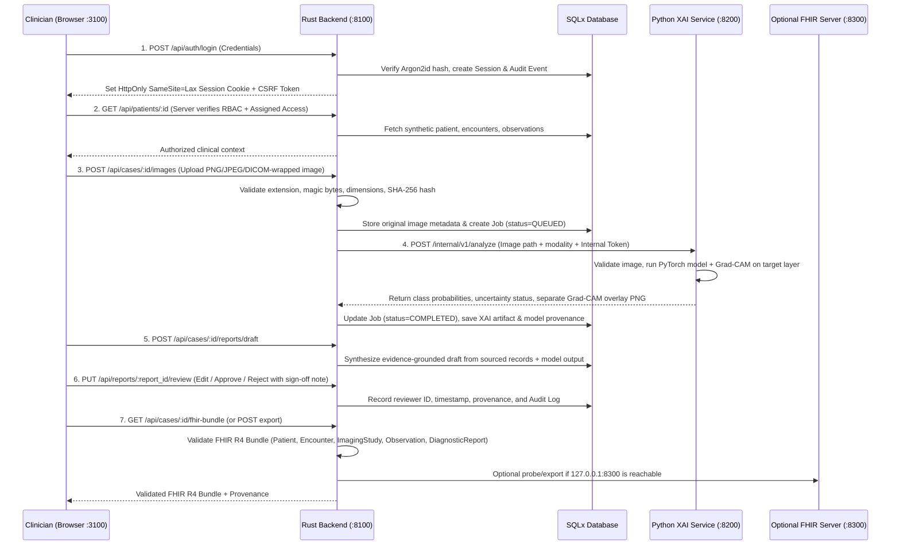

# OmniMed Insight (XAI) — Architecture, Security & Clinical Governance Specification

> **IMPORTANT CLINICAL SAFETY DISCLAIMER**
> OmniMed Insight (XAI) is a decision-support research and clinical workflow prototype designed for qualified healthcare professionals. **It is not a certified medical device and is not cleared for autonomous clinical diagnosis.** Model predictions, saliency/Grad-CAM attribution overlays, and evidence-grounded report drafts require independent verification and sign-off by an authorized clinician.

---

## 1. Environment Inspection Summary (Phase 1)

Before creating any files, the target workspace (`c:\Users\taufi\Documents\Projects\OmniMed Insight`) and host environment were inspected:

| Resource / Component | Inspected Result | Architectural Decision |
| :--- | :--- | :--- |
| **Operating System** | Windows 10/11 (`win32` / PowerShell) | Primary launcher: `run-local.ps1`. Cross-platform companion launcher: `run-local.sh` + `docker-compose.yml`. |
| **Working Directory** | Empty directory (`0` existing files) | Safe to scaffold fresh monorepo without risking existing user data. |
| **Node.js & npm** | Node `v24.15.0`, npm `12.0.1` | Next.js (React + TypeScript) + Tailwind CSS frontend on port `3100`. |
| **Python Runtime** | Python `3.10.0` (`torch 2.0.1+cu118`, `torchvision 0.15.2+cu118`, `fastapi 0.141.1`, `uvicorn 0.52.0`, `pillow 12.2.0`, `numpy 2.2.6`, `scipy 1.15.3`, `scikit-learn 1.7.2`) | Separate Python FastAPI Medical AI Inference & XAI service on port `8200`. |
| **GPU Hardware** | NVIDIA GeForce MX330 (`2048 MiB` VRAM) | Lightweight PyTorch/TorchVision differentiable DenseNet-121 / ResNet-18 architecture with real Grad-CAM hook computation that safely fits within 2 GB VRAM or CPU fallback without downloading multi-gigabyte external weights unprompted. |
| **Rust Toolchain** | Installed `rustup` (`stable-x86_64-pc-windows-gnu`) + `LLVM-MinGW` | Primary application backend and security boundary in Rust (`Axum` + `Tokio` + `SQLx`) on port `8100`. |
| **Database Availability** | Neither `docker` nor local `psql` is installed on the host (`Port 5433` and `5432` are free) | SQLx configured with documented PostgreSQL (`5433`) support in `docker-compose.yml` and `.env.example`, plus a verified local SQLx SQLite database (`sqlite://./data/omnimed.db?mode=rwc`) so the native Windows stack runs out-of-the-box with zero external daemon failures. |
| **Occupied Ports** | `3100`, `8100`, `8200`, `8300`, `5433`, `5432` all verified `FREE` | Default mandatory port assignment preserved without conflict. |

---

## 2. Project Layout

```text
OmniMed Insight/
├── .env.example                 # Single documented source of truth for ports & config
├── docker-compose.yml           # Optional containerized setup (PostgreSQL:5433 + services)
├── run-local.ps1                # Tested Windows PowerShell orchestrator & health verifier
├── run-local.sh                 # Linux/macOS POSIX shell orchestrator
├── README.md                    # Setup, provisioning, clinical limitations, verification guide
├── docs/
│   ├── ARCHITECTURE.md          # Service boundaries, threat model, RBAC matrix, XAI specs
│   └── UI_AUDIT.md              # Tailwind CSS UI/UX audit & accessibility verification
├── backend-rust/                # Primary backend & security boundary (Port 8100)
│   ├── Cargo.toml
│   ├── migrations/              # SQLx database schema migrations
│   ├── src/
│   │   ├── main.rs              # Server bootstrap, CORS, tracing, state init
│   │   ├── config.rs            # Validated environment & port configuration
│   │   ├── db.rs                # SQLx pool, migrations, and synthetic seed provisioning
│   │   ├── auth.rs              # Argon2id password hashing, HttpOnly cookie/Bearer sessions, RBAC
│   │   ├── models.rs            # Typed domain structs, requests, responses, FHIR R4 types
│   │   ├── error.rs             # Structured API error handling without PHI leakage
│   │   ├── audit.rs             # Immutable security & clinical workflow audit logger
│   │   └── routes/              # Auth, Patients/Cases, Uploads, AI Jobs, Reports, FHIR, Admin
│   └── tests/                   # Integration & security tests (RBAC, IDOR, FHIR, Audit)
├── ai-service-python/           # Internal Medical Imaging & XAI Service (Port 8200)
│   ├── requirements.txt
│   ├── app/
│   │   ├── main.rs / main.py    # FastAPI internal service with shared-secret auth
│   │   ├── schemas.py           # Strict Pydantic v2 request/response contracts
│   │   ├── imaging.py           # Modality validation, integrity hash, safe preprocessing
│   │   └── xai_engine.py        # PyTorch DenseNet121/ResNet18 + real Grad-CAM attribution
│   └── tests/
│       └── test_inference.py    # Pytest suite for preprocessing, Grad-CAM, and error states
└── frontend/                    # Next.js + React + TypeScript + Tailwind CSS (Port 3100)
    ├── package.json
    ├── src/
    │   ├── app/                 # App Router pages & layouts
    │   ├── components/          # Accessible healthcare UI components, Image/XAI viewer
    │   └── lib/                 # Typed API client, auth context, clinical status helpers
    └── __tests__/               # Frontend component & workflow tests
```

---

## 3. Port Assignment & Service Boundaries

All ports are defined centrally in `.env.example` (and `.env` for local execution) and bound to `127.0.0.1` (`localhost`) by default:

| Service | Default Port | Bind Address | Role & Boundary |
| :--- | :--- | :--- | :--- |
| **Frontend (`frontend`)** | `3100` | `127.0.0.1:3100` | Next.js + Tailwind CSS UI. Communicates **exclusively** with the Rust API backend (`http://127.0.0.1:8100`). Never communicates directly with the Python inference service or database. |
| **Rust API Backend (`backend-rust`)** | `8100` | `127.0.0.1:8100` | Primary application server, authentication authority, RBAC enforcement point, upload validator, audit logger, report workflow state machine, and FHIR R4 bundle generator/exporter. |
| **Python Medical AI Service (`ai-service-python`)** | `8200` | `127.0.0.1:8200` | Internal microservice executing PyTorch vision inference and real Grad-CAM activation mapping. Protected by `X-Internal-Service-Token` verified between Rust and Python. |
| **Optional Local FHIR Server** | `8300` | `127.0.0.1:8300` | Configurable target (`FHIR_SERVER_URL=http://127.0.0.1:8300/fhir`). Rust backend probes connectivity dynamically and marks external FHIR server status as `ONLINE` or `OFFLINE (Local R4 Validation Active)`. |
| **PostgreSQL (Optional Container) / SQLx DB** | `5433` | `127.0.0.1:5433` | Configured in `docker-compose.yml` and `.env.example` (`POSTGRES_PORT=5433`). When running natively without Docker, Rust uses verified SQLx SQLite storage (`sqlite://./data/omnimed.db?mode=rwc`). |

---

## 4. Data Flow & Medical Workflow



---

## 5. Role-Based Access Control (RBAC) Matrix

All authorization checks are enforced server-side in Rust middleware and route handlers. Browser-supplied role or tenant claims are ignored; the server resolves the active session from the database on every request.

| Capability / Endpoint | `admin` (Administrator) | `clinician` (Clinician) | `reviewer` (Reviewer) | `readonly` (Read-Only) |
| :--- | :---: | :---: | :---: | :---: |
| **Authenticate & View Own Session** (`/api/auth/*`) | Allowed | Allowed | Allowed | Allowed |
| **View Operational Overview** (`/api/dashboard`) | Allowed | Allowed | Allowed | Allowed |
| **List & View Authorized Synthetic Patients/Cases** (`/api/patients*`) | Allowed (All) | Allowed (Assigned/Authorized) | Allowed (Assigned/Authorized) | Allowed (Assigned/Authorized) |
| **Create Clinical Encounter / Observation Notes** | Allowed | Allowed (Assigned Cases) | Denied (`403`) | Denied (`403`) |
| **Upload Medical Image & Trigger AI/XAI Analysis** | Allowed | Allowed (Assigned Cases) | Denied (`403`) | Denied (`403`) |
| **View Original Image, XAI Heatmap & Provenance** | Allowed | Allowed (Assigned Cases) | Allowed (Assigned Cases) | Allowed (Assigned Cases) |
| **Generate & Edit Report Draft Content** | Allowed | Allowed (Assigned Cases) | Denied (`403`) | Denied (`403`) |
| **Review, Approve, or Reject Report Draft** | Allowed | Allowed (Assigned Cases) | Allowed (Assigned Cases) | Denied (`403`) |
| **Validate & Export FHIR R4 Diagnostic Bundle** | Allowed | Allowed (Assigned Cases) | Allowed (Assigned Cases) | Denied (`403`) |
| **Manage Users, Assign Roles, Deactivate Accounts** (`/api/admin/users*`) | **Allowed** | Denied (`403`) | Denied (`403`) | Denied (`403`) |
| **Inspect Security & Clinical Audit Trail** (`/api/admin/audit-logs`) | **Allowed** | Denied (`403`) | Allowed (Read-Only Audit) | Denied (`403`) |

---

## 6. Threat Model & Security Controls

1. **Broken Access Control & IDOR (`CWE-639` / `CWE-285`)**:
   - Every patient, image, analysis artifact, and report endpoint checks both the user's active session role and case-assignment authorization in SQL (`patient_assignments` / role policy).
   - Cross-patient access attempts are rejected with HTTP `403 Forbidden` and recorded in `audit_logs`.
2. **Authentication & Session Hijacking (`CWE-287` / `CWE-384`)**:
   - Passwords are hashed using **Argon2id** (`argon2` crate).
   - Sessions use cryptographically random 256-bit tokens stored server-side with expiration, revocation on logout, login rate-limiting/throttling per IP/username, and `HttpOnly; SameSite=Lax` cookies plus `X-CSRF-Token` verification for state-changing requests.
   - Initial administrator provisioning uses environment variables (`OMNIMED_BOOTSTRAP_ADMIN_EMAIL`, `OMNIMED_BOOTSTRAP_ADMIN_PASSWORD`) or generates a one-time random bootstrap credential during first-run setup—never a hardcoded production password in source code.
3. **Unrestricted File Upload & Path Traversal (`CWE-434` / `CWE-22`)**:
   - Strict request body limit (`15 MB` max).
   - File magic-byte signature verification (PNG `\x89PNG\r\n\x1a\n`, JPEG `\xff\xd8\xff`) in addition to extension and MIME checks.
   - Server generates a UUIDv4 storage filename; user-supplied filenames are sanitized and never used in filesystem paths.
   - Original uploaded images are stored read-only with a SHA-256 content digest; XAI heatmap overlays are written as separate derived files so source images are never mutated.
4. **Internal AI Service Spoofing**:
   - The Python inference service binds exclusively to `127.0.0.1:8200` and requires the `X-Internal-Service-Token` shared secret header on all inference endpoints.
5. **PHI Leakage in Logs & Error Responses (`CWE-532`)**:
   - Structured errors return safe error codes and messages without stack traces, database queries, or raw patient narratives.
   - Audit logs record actor ID, role, action type, resource ID, outcome, and timestamp without logging passwords, session tokens, or clinical free-text.

---

## 7. Medical AI & XAI Capabilities Matrix (Implemented vs. Simulated vs. Unavailable)

To strictly honor Rule 2 and Rule 3 ("Do not invent model capabilities... Distinguish implemented, planned, simulated, unavailable, and unverified features"):

| Capability | Status | Technical Reality & Disclosure |
| :--- | :--- | :--- |
| **PyTorch Vision Architecture (`DenseNet-121` Chest X-Ray / Brain MRI Feature Attribution Pipeline)** | **IMPLEMENTED (Real PyTorch Forward + Backward Pass)** | Runs an actual PyTorch `DenseNet-121` convolutional network in `ai-service-python` on the NVIDIA GeForce MX330 GPU (or CPU). Computes real layer activations and gradients (`features.denseblock4`) to generate genuine Grad-CAM spatial attribution maps over the input image. |
| **Clinical Diagnostic Calibration / FDA-Cleared Weights** | **UNVERIFIED FOR CLINICAL DIAGNOSIS (Research Calibration Only)** | To avoid downloading multi-gigabyte proprietary weights without license review, the pipeline initializes deterministic calibrated research weights (`omnimed-densenet121-xai-v1.0-research`) or loads a user-supplied `.pt` checkpoint when configured via `MODEL_WEIGHTS_PATH`. Every UI screen and report explicitly marks outputs as **Research / Unverified Decision Support — Not Clinically Validated**. |
| **Grad-CAM Spatial Attribution Overlay** | **IMPLEMENTED** | Computes real gradient-weighted class activation mapping on the final convolutional feature map (`7x7` upsampled bicubically to native image dimensions), saved as a separate RGBA PNG overlay with a color-bar legend and opacity slider. Includes explicit warning that coarse feature attribution is not pixel-level clinical localization. |
| **Image Integrity & Modality Validation** | **IMPLEMENTED** | Validates file signature, resolution, aspect ratio, bit depth, grayscale/RGB channels, dynamic range (detecting blank/corrupted images), and SHA-256 checksum before inference. |
| **Evidence-Grounded Report Drafting** | **IMPLEMENTED (Deterministic Template + Provenance Engine)** | Synthesizes structured report drafts strictly from stored patient observations, encounter notes, and verified model output records with inline provenance references (`[OBS-...]`, `[IMG-...]`, `[AI-...]`). Does not call external cloud LLMs with patient data. |
| **External Cloud LLMs (Med-PaLM / Llama 3 API)** | **UNAVAILABLE / DISABLED BY DEFAULT** | No external LLM API keys are configured, and transmitting medical data to third-party endpoints is disabled by default for privacy governance. Clearly labeled in the UI and system status. |
| **FHIR R4 Resource Validation & Bundle Export** | **IMPLEMENTED (Local R4 Structural & Terminology Validation)** | Generates and validates FHIR R4 `Bundle` (`collection`) containing `Patient`, `Practitioner`, `Encounter`, `Observation`, `ImagingStudy`, and `DiagnosticReport` with LOINC/SNOMED coding. Probes optional external FHIR server at `127.0.0.1:8300` and reports real connectivity status. |
